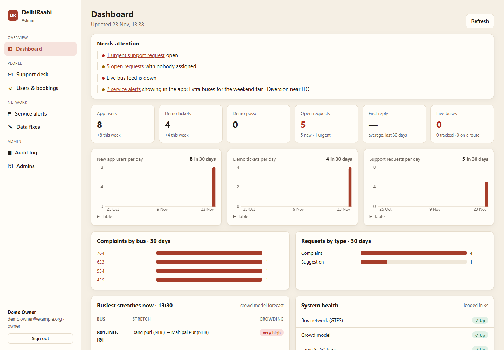
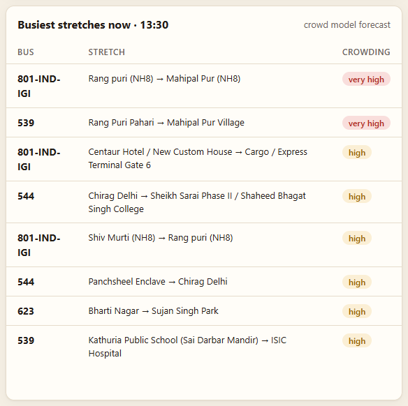
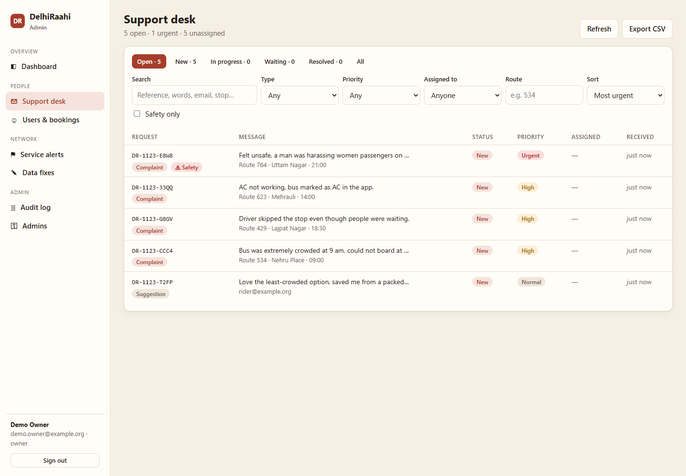
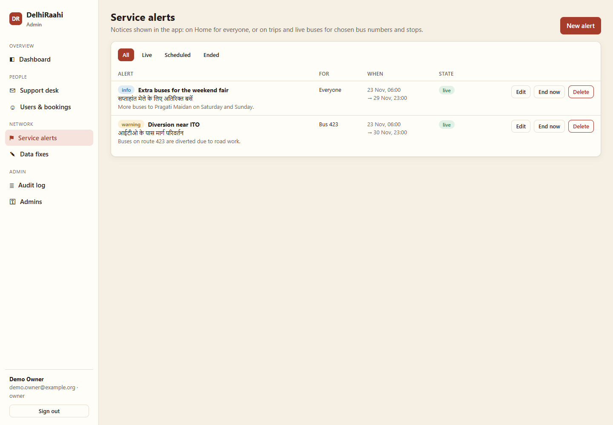
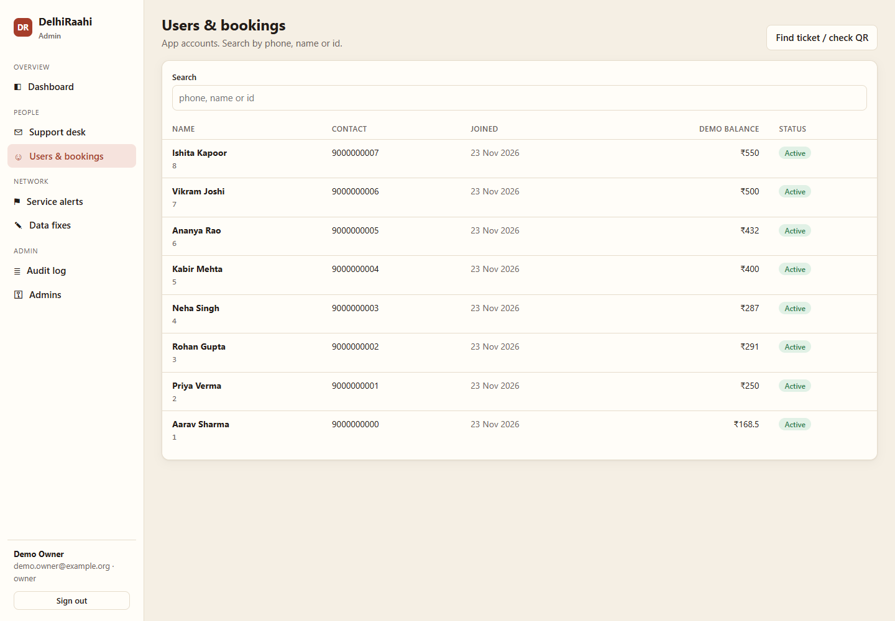

# DelhiRaahi 🚌

**See how crowded your Delhi bus will be — before you board.**

Transport Stack Hackathon 2026 · Problem 2: crowdedness-aware journey planner

---

## The idea in 30 seconds

Delhi buses get very crowded at some times and on some stretches. Riders usually find out only when the
bus arrives.

DelhiRaahi learns from **one month of real bus e-tickets (2.56 million)** how busy each part of each
route usually is, for every half hour of the day. When you plan a trip, every option shows:

- ⏱️ how long it takes
- 👥 how crowded it is likely to be (low → very high)
- 💰 the fare

You can then sort by **Fastest**, **Balanced** or **Least crowded** — and maybe take a calmer bus that is
only a few minutes slower.

> 📄 **Want the details?** Read the [technical note](docs/technical_note.md): how it works, accuracy,
> and where the estimates are weakest.

---

## What's included

| Part | What it does | Folder |
|---|---|---|
| 📱 **Android app** (for riders) | Plan a trip with crowd levels, live buses, demo tickets, voice help, English + हिंदी | `android/` |
| 🖥️ **Admin website** (for operators) | Dashboard, crowd hotspot map, complaints, users, service alerts, audit log | `admin/` |
| ⚙️ **Backend server** | Data pipeline, crowd model, journey planner, fares, the API used by the app and website | `backend/` |
| 🧪 **Scripts** | Re-run the whole pipeline from raw tickets to crowd estimates | `scripts/` |
| 📚 **Docs** | Technical note, demo script, development plan | `docs/` |

Older prototypes (`frontend/` web version, `mobile/` Expo version) are kept for reference only.

> ⚠️ **Demo only:** tickets and passes in the app are marked *DEMO — not valid for travel*. No real money
> is taken.

---

## Screenshots

### 🖥️ Admin website

**Dashboard** — users, bookings, complaints and system health at a glance.



<table>
  <tr>
    <td width="50%"><b>Crowd hotspots</b> — the most crowded bus stretches right now, from the crowd model.<br><br>
      </td>
    <td width="50%"><b>Support desk</b> — rider complaints sorted by urgency; safety issues are flagged first.<br><br>
      </td>
  </tr>
  <tr>
    <td width="50%"><b>Service alerts</b> — notices in English and Hindi, shown inside the app.<br><br>
      </td>
    <td width="50%"><b>Users &amp; bookings</b> — rider accounts, demo wallets and tickets.<br><br>
      </td>
  </tr>
</table>

<sub>Screenshots use made-up demo riders and requests, not real user data.</sub>

---

## How it works

```
 Raw e-tickets ──► Clean & match to ──► Count riders on ──► Crowd model ──► Journey planner ──► App / Website
 (Oct 2026)        routes and stops     each stretch,       (LightGBM +     (ranks options by
                                        every 30 min        calibration)    time + crowd)
```

1. **Clean the tickets** and match each one to a bus route and its boarding and alighting stops.
2. **Count** how many people ride each stretch of each route, every half hour.
3. **Train a model** that predicts this for any day and time, with a range showing how sure it is.
4. **Plan journeys** on the Delhi bus network and show the expected crowd level next to each option.

---

## Run it yourself

### What you need

- **Python 3.12** (for the backend)
- **Node 20+** (only for the admin website)
- **JDK 17 + Android SDK** (only for the Android app)

### Step 1 — Install

```bash
python -m venv .venv
.venv/Scripts/pip install -r requirements.txt      # on Linux/macOS: .venv/bin/pip
cp .env.example .env                               # optional: add TS_API_KEY for live buses
```

### Step 2 — Get the data

The raw data can't be shared here (licence). Download it from
[delhi.transportstack.in](https://delhi.transportstack.in) and put it here:

| File | Where it goes |
|---|---|
| `October-Delhi.csv` (bus e-tickets, 1–31 Oct 2026) | `data/raw/October-Delhi.csv` |
| Delhi buses GTFS (zip) | unzip into `data/gtfs/` — or run `python scripts/fetch_gtfs.py` with `TS_API_KEY` |

### Step 3 — Build the crowd estimates

```bash
python scripts/run_pipeline.py     # tickets → routes, stops, stretch demand      (~2.5 min)
python scripts/train_model.py      # train model + check accuracy on a test week (~5 min)
python scripts/check_patterns.py   # check peaks, weekends, busy corridors        (~1 min)
python scripts/validate_fares.py   # check fares against real ticket amounts
```

Results go to `data/processed/`, `models/artifacts/` and `models/metrics/`.

### Step 4 — Start the server

```bash
cd backend
../.venv/Scripts/python -m uvicorn app.main:app --host 0.0.0.0 --port 8010
```

Open **http://localhost:8010/docs** to try the API in your browser.

Without `TS_API_KEY` there are no live buses (timetables are used instead). Without a Firebase key,
accounts are stored locally. Neither is needed to test the crowd model.

<details>
<summary>Example API calls</summary>

```bash
curl "localhost:8010/api/v1/stops/search?q=kashmere"
curl "localhost:8010/api/v1/crowd/route/<route_id>?date=2026-11-20"             # crowd through the day
curl "localhost:8010/api/v1/crowd/route/<route_id>?date=2026-11-20&time=08:30"  # stop by stop
curl "localhost:8010/api/v1/crowd/hotspots?time=08:30"
curl -X POST localhost:8010/api/v1/journeys/search -H "Content-Type: application/json" \
     -d '{"origin":{"type":"stop_name","name":"GGS University ISBT Kashmere Gate"},
          "destination":{"type":"stop_name","name":"Anand Vihar ISBT"},
          "departure_datetime":"2026-11-20T18:00:00+05:30","preference":"least_crowded"}'
```
</details>

### Step 5 — Admin website (optional)

```bash
cd admin && npm install && npm run build
cd ../backend && ../.venv/Scripts/python scripts/create_admin.py --email you@example.org --name "You" --role owner
```

1. A one-time password is saved to `data/admin/new_admin_password.txt` (it is never printed).
2. Sign in at **http://localhost:8010/admin** and choose your own password.
3. Delete the password file.

Forgot your password? Run the same script with `--email you@example.org --reset`.

### Step 6 — Android app (optional)

Add these two lines to `android/local.properties`:

```
api.base=http://<your-computer's-Wi-Fi-IP>:8010
MAPS_API_KEY=<your Google Maps SDK key>
```

Then build and install:

```bash
cd android
./gradlew assembleDebug
adb install -r app/build/outputs/apk/debug/app-debug.apk
```

Phone and computer must be on the **same Wi-Fi**. If the address changes, update it in the app under
**Account → Advanced → Server** (include `:8010`).

---

## Tests

```bash
cd backend && ../.venv/Scripts/python -m pytest -q     # 154 tests
cd android && ./gradlew testDebugUnitTest              # app unit tests
```

---

## Key results

All numbers come from `models/metrics/` and are explained in the technical note.

| What we checked | Result |
|---|---|
| Tickets matched to a route | **99.98 %** of 2.56 M |
| Tickets matched to an exact stop-to-stop path | **87.4 %** |
| Accuracy on a held-out test week (25–31 Oct) | Matches a strong "same as usual" baseline (WAPE 0.717 vs 0.710); **0.21–0.31** WAPE where there are 300+ tickets |
| 80 % prediction ranges | Actually contain the true value **77–82 %** of the time |
| Peak hours found | **09:00** and **18:00** on weekdays |
| Weekends and holidays | Sundays and holidays have about **half** the weekday riders |
| Morning vs evening direction | Busier direction flips on **76 %** of two-way routes |
| Fares | Exact match for **82 %** of tickets, within one fare step for **99.4 %** |

---

## Limitations

- We only have **e-tickets** — no paper tickets (ETM) or passes. So crowd levels are **relative**
  ("busier than usual"), not exact passenger counts.
- E-ticket use differs between routes, and bus size is unknown, so comparing two different routes is less
  reliable than comparing times on the same route.

More details, and what would fix each one, are in the
[technical note](docs/technical_note.md#6-where-the-estimates-are-least-reliable).
